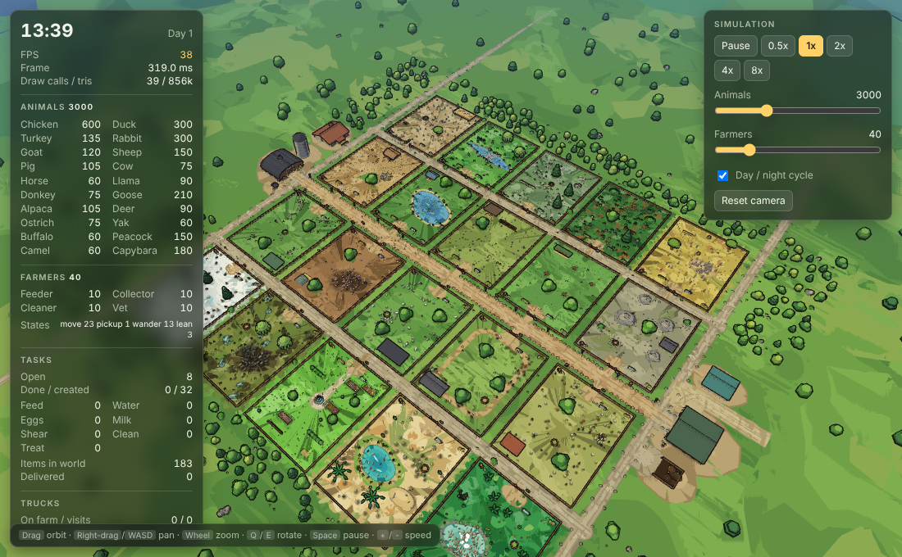
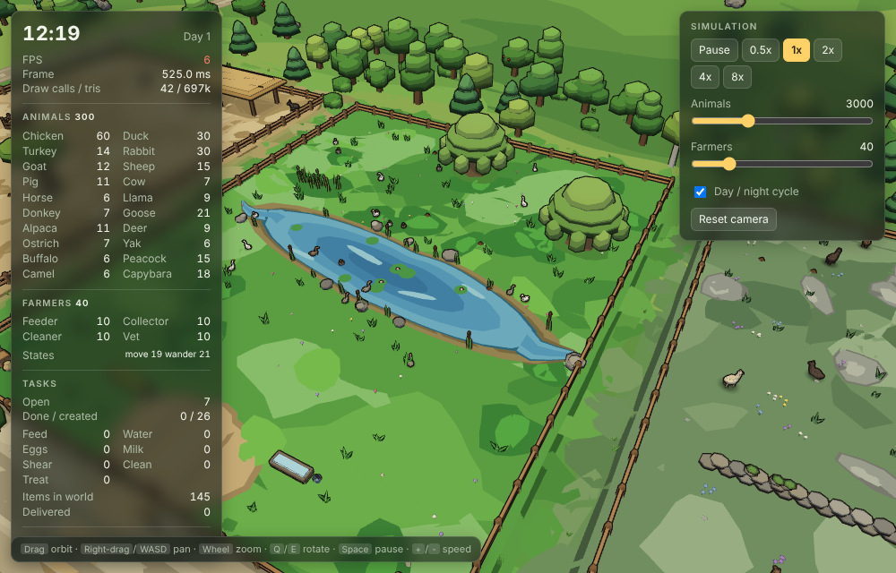
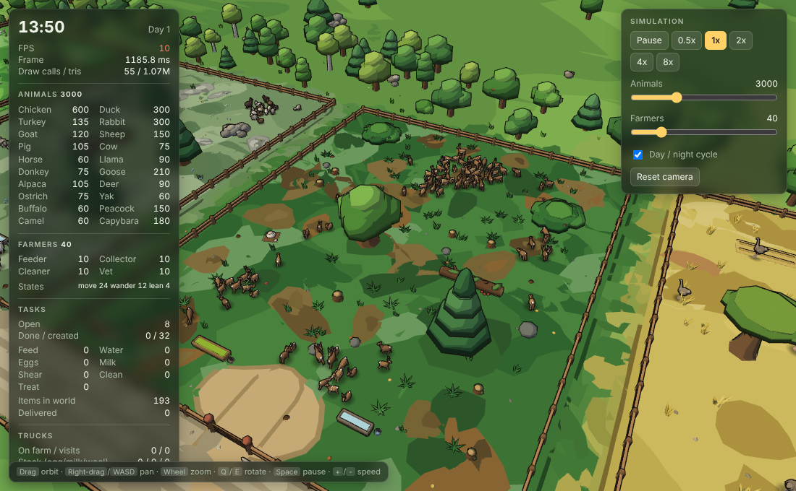
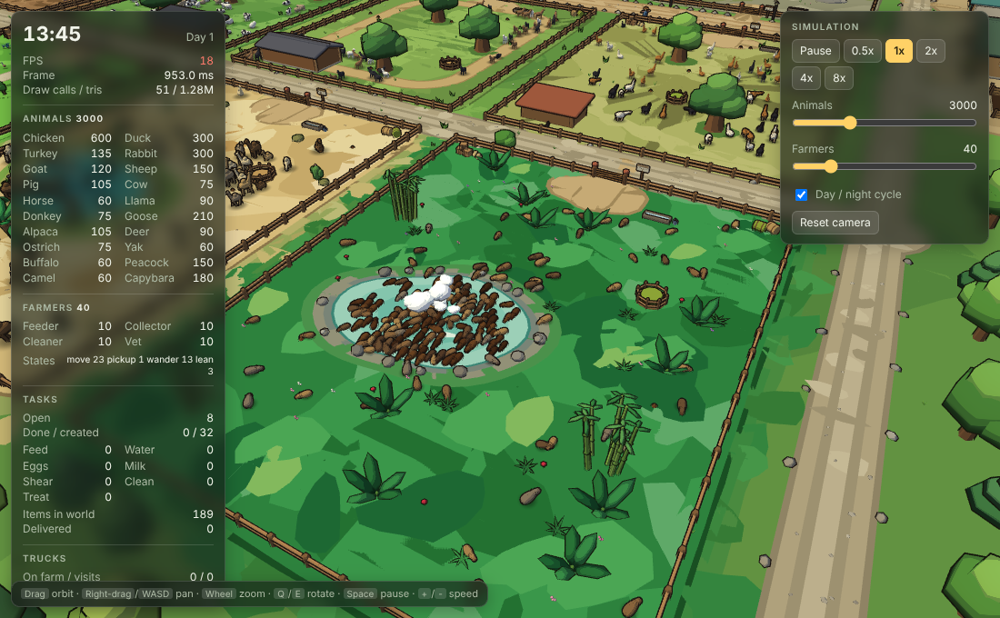
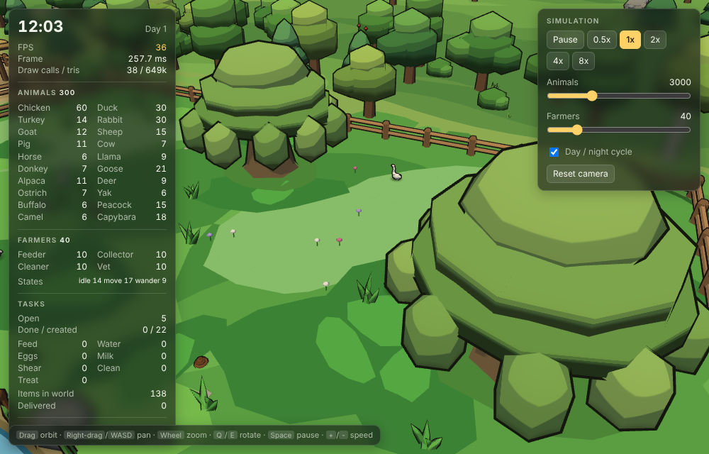

# FarmSim

**A living low-poly farm, rendered in raw WebGL2 with zero dependencies.**
Twenty animal species in twenty fenced pens, up to 10,000 animals and 200 farmers doing their own chores, trucks that
arrive, get loaded by the farmers and leave, all in a cel-shaded, inked cartoon style.



Dedicated to the public domain under [CC0 1.0](LICENSE).

## Quick start
```
python3 serve.py            # http://localhost:8080/  (no-cache dev server; use this, not http.server)
npm run test:unit           # simulation, ECS, farmer, obstacle, rig and truck tests (Node, no browser)
npm run test:e2e            # headless Chromium smoke test (Playwright + SwiftShader)
npm run bench               # simulation tick timing at 2k / 5k / 10k animals
```
No install step, no bundler, no runtime dependencies. Node is only needed for the tests.

## What it is
FarmSim is a technical demo of a data-oriented farm simulation with a hand-written renderer. Animals have needs and
choose what to do: they graze, peck, wallow, bathe, sleep and flee. Farmers work through tasks (feed, water, collect eggs
and milk, shear, clean, treat sick animals) and carry goods to trucks. Trucks visit the farm on a schedule and leave with
their cargo. Day turns to night, and the lighting, outlines and fog follow.

| Pen | Species | Biome |
|---|---|---|
| 0–9 | chicken, duck, turkey, rabbit, goat, sheep, pig, cow, horse, llama | coop, pond, roost, warren, crag, meadow, mud yard, pasture, paddock, highland |
| 10 | donkey | dry corral |
| 11 | goose | riverbank |
| 12 | alpaca | alpine |
| 13 | deer | forest |
| 14 | ostrich | savanna |
| 15 | yak | snow |
| 16 | buffalo | marsh |
| 17 | peacock | garden |
| 18 | camel | desert |
| 19 | capybara | tropical |

Pens sit on a 5 × 4 grid with service lanes between rows. Each biome has its own ground, decor and features. A few trees
stand in most pens, and the animals and farmers route around them.

## Showcase

| | |
|---|---|
|  |  |
| Riverbank: a stream-shaped pond, reeds and geese that follow the flock | Forest: round-crowned oaks and pines, logs, and deer that scare and freeze |
|  |  |
| Desert: an oasis with a reed fringe, palms and a camel herd | Willows: domed crowns over soft, rounded skirts |

## Technical highlights
- **Scale.** 20 species, up to 10,000 animals and 200 farmers. The default load is 3,000 animals and 40 farmers.
- **Simulation without a renderer.** The sim (`src/config.js`, `src/ecs/`, `src/sim/`) has no DOM or WebGL and runs under
  Node. It can be tested and benchmarked on its own. Measured in Node at 10,000 animals and 200 farmers: about 3.4 ms
  average per 1/30 s tick, with occasional garbage-collection spikes.
- **Data-oriented ECS.** Struct-of-arrays typed arrays for animals, farmers, items, tasks and pens. Dense arrays, no
  per-entity objects, and no allocation in the hot loops. A counting-sort spatial hash, rebuilt every tick, gives
  neighbour queries.
- **Steering around the world.** Animals look ahead, bend their heading around circular obstacles, and slide along
  rectangles. A jam rescue flips the avoid side when an animal is blocked. Farmers' routes detour around trunks with a
  clearance margin. A flood-fill test checks that every feeder, trough and nest in every pen is reachable.
- **Hand-written WebGL2 renderer.** Instanced meshes, one draw per part type, LOD and culling. Instance buffers grow by
  doubling, so buffers are sized to live counts rather than the maximum.
- **Cel shading and inked outlines.** Three shading bands from the sun's N·L, warm light and cool shadow, and an
  inverted-hull outline pass with a width clamped to 1.2–4 px on screen so crowds stay readable.
- **Round decals.** Spots and patches are flat ellipsoids sunk into the surface and excluded from the outline. No
  stair-stepped patterns.
- **Three LOD tiers and an adaptive budget.** Near, far (one coarse mesh per species) and a shared blob beyond that.
  If the frame exceeds 2.5 M triangles or 120 draw calls, the near-detail distance shrinks smoothly, then recovers.
- **Boot diagnostics.** A failed start shows the stack trace on screen instead of a blank page.

## Best practices
- **Separation of concerns.** Pure simulation modules, a renderer that reads them, and an orchestrator (`src/main.js`)
  that wires them together. Each module owns its files.
- **Zero allocation in hot loops.** Scratch typed arrays are module-level. Systems cache arrays in locals.
- **Seeded randomness.** Worlds are reproducible from a seed, which makes failures repeatable in tests.
- **Test at three levels.** Unit tests on the simulation under Node (world, animals, farmers, obstacles, rig, trucks);
  a headless browser smoke test on the real app with no console errors allowed; and a benchmark that tracks tick cost.
- **One design language, written down.** `DESIGN_LANGUAGE.md` holds the palette, outline widths, decal rules and
  performance budgets, so new assets stay consistent.
- **Honest performance notes.** Measured numbers are labelled with where they were measured.
- **Dev server with no-cache headers.** Module edits are picked up on refresh without stale mixes of old and new files.

## Known limits
- Frame rate on a real GPU at 10,000 animals and 200 farmers is not measured. Headless SwiftShader runs are not
  representative.
- The yak and palm fronds are the weakest visual assets.
- Trucks, cargo and loading work, but the economy is deliberately simple.

## Documentation
- [PLAN.md](PLAN.md): architecture, data layout and module responsibilities.
- [DESIGN_LANGUAGE.md](DESIGN_LANGUAGE.md): look, outlines, palette, biomes and performance budgets.

## Layout
```
src/config.js        constants, species, pens, features, biome palettes
src/ecs/             typed-array world, RNG, spatial hash          (no DOM, no WebGL)
src/sim/             animals, tasks, farmers, navigation, trucks   (no DOM, no WebGL)
src/render/          GL engine, rigs, unit and environment renderers, trucks, camera
src/ui/hud.js        overlay            src/qa.js  automation hooks
tests/               unit, smoke and benchmark scripts
debug/               pages for inspecting the species lineup and environment
```

## Credits
Built as a technical demonstration. All code and assets are released under CC0 1.0 (see [LICENSE](LICENSE)).
